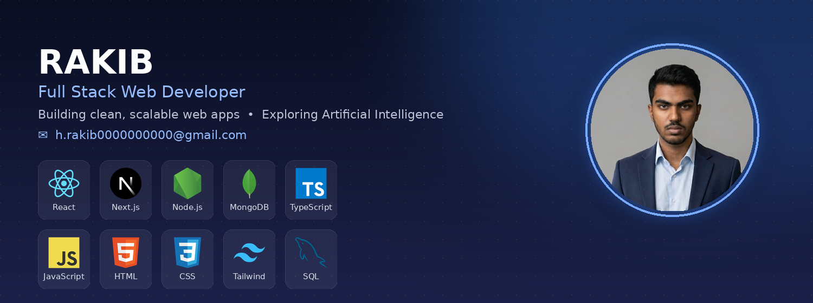

<h1 align="center">Hi 👋, I'm Rakib </h1>


<p align="center">
  <strong>Full Stack Web Developer building scalable, AI-ready web applications.</strong>
</p>

I'm Rakib, a Full Stack Web Developer based in Rangpur, Bangladesh. I build clean, responsive web apps with React, Next.js, Node.js, MongoDB and TypeScript, and I'm exploring AI-powered web apps and chatbot automation.

---

## About Me

Hi! I'm **Rakib**, a passionate **Future Full Stack Developer** from Bangladesh 🇧🇩.

- 🎓 Currently pursuing a **Diploma in Computer Science & Technology** at Rangpur Polytechnic Institute
- 🎓 Enrolled in Programming Hero's **AI-Driven Full Stack Web Engineering** program (Batch 14)
- 💻 Building modern and responsive web applications
- ⚛️ Working with **React, TypeScript, JavaScript & Tailwind CSS**
- 🚀 Currently learning **Next.js, Node.js, Express.js & MongoDB**
- 🧠 Passionate about **problem solving and clean UI/UX**
- 🔨 Building projects to strengthen my **Full Stack Development** skills
- 🌱 Continuously learning and improving my development skills
- 🤝 Open to **collaboration, open-source projects & learning opportunities**
- 🌐 Learning networking fundamentals (Cisco Packet Tracer — DHCP, RIP, OSPF, EIGRP), which gives me an advantage in web security
- 🔐 Hands-on with cybersecurity fundamentals (TryHackMe, SOC concepts, recon tooling)
- ✍️ I write code that explains **why**, not just what — clarity over cleverness, always
- 🚀 Open to internships, freelance work, and collaborative full-stack projects

---

## Tech Stack

### Frontend

<p>
  
  
  
  
  
  
  
  
  
  
</p>

### Backend

<p>
  
  
  
  
</p>

### Database

<p>
  
  
  
  
  
</p>

### Tools

<p>
  
  
  
  
  
  
  
  
  
  
  
  
  
  
  
  
  
  
</p>

---

## Featured Projects

| Project | Description | Tech used | Live link | Repo link |
|---|---|---|---|---|
| Sign-up-Sign-in | Full-stack Next.js and TypeScript app with Better Auth and MongoDB sign-up/sign-in. | Next.js, TypeScript, MongoDB, Better Auth | [ADD: live URL] | [Sign-up-Sign-in](https://github.com/Rakib304832/Sign-up-Sign-in) |
| NextBlog-Ul | Blog application built with Next.js and TypeScript. | Next.js, TypeScript | [ADD: live URL] | [NextBlog-Ul](https://github.com/Rakib304832/NextBlog-Ul) |
| User_API_from_Database- | REST API for user data with CRUD operations. | Node.js, Express, MongoDB | [ADD: live URL / API base URL] | [User_API_from_Database-](https://github.com/Rakib304832/User_API_from_Database-) |
| Salon app | Client interface and TypeScript server for a salon application. | HTML, TypeScript | [ADD: live URL] | [salon-client](https://github.com/Rakib304832/salon-client) / [Salon-server-site](https://github.com/Rakib304832/Salon-server-site) |
| portfolio-website | Portfolio website built with TypeScript. | TypeScript | [ADD: live URL] | [portfolio-website](https://github.com/Rakib304832/portfolio-website) |

---

## Currently Focused On

- Building AI-powered web applications and exploring chatbot automation
- Strengthening full-stack engineering with React, Next.js, Node.js, MongoDB and TypeScript
- Completing Programming Hero's AI-Driven Full Stack Web Engineering program (Batch 14)

---

## Let's Connect

- Email: [h.rakib0000000000@gmail.com](mailto:h.rakib0000000000@gmail.com)
- LinkedIn: [Rakib Hassan](https://bd.linkedin.com/in/rakib-hassan-3aa624440) — [ADD: confirm LinkedIn profile URL]
- Portfolio: [rakibwebsite.netlify.app](https://rakibwebsite.netlify.app/)
- Resume: [ADD: resume/CV URL]
- GitHub: [Rakib304832](https://github.com/Rakib304832)

### Where you find me

<p>
  <a href="https://bd.linkedin.com/in/rakib-hassan-3aa624440">
     
  </a>
  <a href="https://x.com/HRaki46262">
    
  </a>
</p>

---

## 🌱 Currently Learning

<p>
  
  
  
  
  
  
  
  
  
  
  
</p>

---

## 🛠️ Technologies & Tools

### Languages:

<p>
  
  
  
  
  
  
</p>

### CSS Frameworks & Libraries:

<p>
  
  
  
</p>

### JavaScript Frameworks & Libraries:

<p>
  
  
  
  
  
</p>

### Database & ORM:

<p>
  
  
  
  
  
</p>

### Deployment Platform:

<p>
  
  
  
</p>

### Design & Graphics:

<p>
  
  
  
</p>

### Tools & Technologies:

<p>
  
  
  
  
  
  
  
  
</p>

### Networking & Security

<p>
  
</p>

---

### 🔥 GitHub Streak

<p align="center">
 
  
  
  
  
</p>

<div align="center">


</div>

---

## 🐍 CONTRIBUTION SNAKE

<!-- Original reference kept: https://raw.githubusercontent.com/Platane/snk/output/github-contribution-grid-snake-dark.svg -->

<div align="center">


</div>

---

## 📚 Learning Journey

```text
HTML → CSS → JavaScript
              ↓
          TypeScript
              ↓
            React
              ↓
           Next.js
              ↓
      Node.js + Express
              ↓
           MongoDB
              ↓
       Full Stack Developer 🚀

```
<br/>

<!-- ═══════════════════════════════════════════════════════════════════════════ -->
<!-- 💡 RANDOM DEV QUOTE                                                         -->
<!-- ═══════════════════════════════════════════════════════════════════════════ -->

<div align="center">
  
### 💭 Random Dev Quote

<br/>

<a href="https://github.com/red1-for-hek">
  
</a>

</div>

<br/>

<!-- ═══════════════════════════════════════════════════════════════════════════ -->
<!-- 🌟 FOOTER                                                                   -->
<!-- ═══════════════════════════════════════════════════════════════════════════ -->

<div align="center">
  
  <p>Thanks for stopping by — open to freelance work, internships and collaborations.</p>
  
  <br/><br/>
  
  
  
</div>

<!-- ═══════════════════════════════════════════════════════════════════════════ -->
<!-- 📝 END OF README                                                            -->
<!-- ═══════════════════════════════════════════════════════════════════════════ -->
